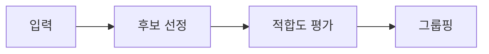

# Ad Curator 솔루션 정책서

---

## 문서 이력

| 날짜          | 수정자 | 수정 내용 | 사유  | VER. |
| ----------- | --- | ----- | --- | ---- |
| 2026. 11. 6 | 서보라 | 초안 작성 | -   | 0.1  |

---

📢 본 정책서는 ReadySet 플랫폼 내 Ad Curator 솔루션의 운영 원칙, 입출력 정의, 큐레이션 생성 정책, SpinX 적용 범위를 정의합니다.

- 현재 버전: v0.1
- 관리자: 서보라
- 요구사항 출처: `Ad_Curator_PRD_v0.1.md`
- 공통 정책 참조: `예측분석_고도화_프로젝트_정책서_v0.1.md` (플랫폼 구조, 사용자 권한, Slot 가시성, 시나리오 관리, 비동기 처리, Export 정책 등)

---

# 1. Ad Curator 정의

## 1.1 솔루션 개요

Ad Curator는 캠페인 조건에 따라 수많은 매체·상품 중 집행 가능한 후보를 선별하고, 데이터 기반 적합도에 따라 그룹핑한 결과를 제공하는 솔루션이다.

## 1.2 대상 매체

| 구분                         | 매체                                                                                    |
| -------------------------- | ------------------------------------------------------------------------------------- |
| 정의된 8개 매체의 광고상품            | Google Ads, Meta, NAVER 보장형 DA, NAVER 성과형 DA(GFA), kakao 모먼트, TikTok, SMR, Targetpick |
| BRIDGE 수집 매체 (상품 정의된 매체 외) | BRIDGE에서 집행 데이터를 수집하는 그 외 매체                                                          |
| 그 외 버티컬 매체                 | -                                                                                     |

# 2. 큐레이션
## 2.1 큐레이션 정의
큐레이션은 Ad Curator에서 캠페인 조건으로 매체 및 상품을 선별하고 결과를 관리하는 기본 단위이다.

### 2.1.1 큐레이션 관리 기능

| 기능   | 정의                                       |
| ---- | ---------------------------------------- |
| 생성   | Slot 내에서 신규 큐레이션를 생성.                    |
| 조회   | 생성 완료된 큐레이션 결과를 확인.                      |
| 수정   | ※ 미제공. 생성된 큐레이션 결과는 수정이 불가함.             |
| 삭제   | 불필요한 큐레이션를 삭제. 삭제된 큐레이션은 복구할 수 없음.       |
| 복제   | 기생성된 큐레이션의 설정을 복사하여, 새로운 큐레이션 생성 값으로 적용. |
| 이동   | 큐레이션을 동일 광고주 내 다른 Slot으로 위치 변경.          |
| 내보내기 | 큐레이션 결과 데이터를 엑셀 형식으로 다운로드.               |

### 2.1.2 큐레이션 속성

| 구분     | 속성명       | 필수 여부  | 설명                                     |
| ------ | --------- | ------ | -------------------------------------- |
| 식별자    | 큐레이션 ID   | 필수     | 큐레이션 생성 시 자동으로 부여되는 고유 번호(PK, 자동 증분)   |
|        | 큐레이션명     | 필수     | 사용자가 큐레이션을 구분하기 위해 입력한 이름              |
|        | 설명        | 선택     | 큐레이션의 목적이나 참고 사항을 기록하는 메모              |
| 캠페인 설정| 업종        | 필수     | 선택한 "광고주 > 브랜드"에 해당하는 업종 또는 선택 업종            |
|        | 캠페인 기간    | 필수     | 캠페인 집행 시작일과 종료일                        |
|        | 캠페인 목적    | 필수     | 캠페인을 통해 달성하려는 목적                        |
| 상태     | 처리 상태     | 필수     | 큐레이션 생성 요청의 현재 상태                      |
|        | 진행 단계     | 필수     | 작업 서버가 실시간으로 전달하는 작업 진행 단계             |
| 메타데이터  | 생성자       | 필수     | 큐레이션 생성을 요청한 사용자의 이름과 이메일 주소           |
|        | 생성일시      | 필수     | 큐레이션 생성을 요청한 일시(`yyyy-mm-dd hh:mm:ss`) |
|        | 완료일시      | 필수     | 큐레이션 생성이 완료된 일시(`yyyy-mm-dd hh:mm:ss`) |

### 2.1.3 큐레이션 처리 상태
상태는 실시간으로 추적하며, 화면 새로고침 없이 상태 변경 사항을 동일 화면에 즉시 반영한다.

| 상태         | 설명                                           |
| ---------- | -------------------------------------------- |
| Pending    | 큐레이션 생성 요청이 접수되어 작업 실행을 기다리는 상태              |
| Processing | 큐레이션을 생성 중인 상태                               |
| Completed  | 큐레이션 생성이 완료되어 결과 화면에 진입할 수 있는 상태             |
| Error      | 모델 실행 실패 또는 처리 중 발생한 오류로 큐레이션 생성을 완료하지 못한 상태 |

### 2.1.4 큐레이션 비동기 처리
모든 큐레이션 생성은 비동기 방식으로 처리되며, 아래의 단계가 기초가 된다.

| 순서   | 단계     | 내용                                                                                   |
| ---- | ------ | ------------------------------------------------------------------------------------ |
| 1    | 생성 요청  | 사용자가 큐레이션 생성을 요청하면 목록에 해당 큐레이션이 추가되고, 상태는 `[Pending]`으로 표시                           |
| 2    | 생성 작업중 | 큐레이션 생성 프로세스가 시작되면 상태를 `[Processing]`으로 변경하고, 생성 진행 단계를 실시간으로 표시                     |
| 3    | 생성 완료  | 생성 작업이 완료되면 상태를 `[Completed]`로 변경하고, 완료된 큐레이션의 결과 화면으로 이동 가능                         |
| 단계 외 | 오류 발생  | 생성 작업 중 오류(실패) 발생 시 상태를 `[Error]`로 변경하고, 오류 발생 일시 표시. 결과 화면으로 이동 불가 |

# 3. 큐레이션 생성

## 3.1 생성 프로세스

| 순서  | 단계     | 내용                                             |
| --- | ------ | ---------------------------------------------- |
| 1   | 입력     | 기본 입력(필수) + 상세 입력(선택)                          |
| 2   | 후보 선정  | 매체.상품 라벨 기반 입력된 조건에 부합한 후보 선정(T/F 조건). 후보 0개 시 상세 입력 조건 일부 제외 (3.3.1) |
| 3   | 적합도 평가 | 선정된 후보 중 업종, 캠페인 KPI 등을 고려하여 적합도 평가     |
| 4   | 그룹핑    | 적합도 평가에 따라 Best Fit / Good Fit / Low Fit으로 그룹핑 |
| 5   | 결과     | 선별된 매체.상품 목록 (매체·상품 설명 / 선정 근거 / 프로모션 표시)        |

### 3.1.1 생성 진입

| 진입 경로           | 설명                                            |
| --------------- | --------------------------------------------- |
| Slot 내 생성       | Slot 내 생성 버튼 → 하위 메뉴에서 Ad Curator 선택          |
| DataShot 결과 CTA | DataShot 결과 화면 CTA → 모달 → 맥락이 프리필된 큐레이션 생성 화면 |
* 생성은 Admin·Marketer만 가능하다 (공통 권한 매트릭스)

## 3.2 생성 입력

| 구분              | 속성명         | 필수 여부 | 설명                                               | 비고                               |
| --------------- | ----------- | ----- | ------------------------------------------------ | -------------------------------- |
| 기본 정보           | 큐레이션명       | 필수    | 큐레이션을 구분할 이름 입력                                  |                                  |
|                 | 설명          | 선택    | 큐레이션의 목적이나 참고 사항 입력                              |                                  |
| 브랜드/업종          | 업종 결정 방식    | 필수    | 브랜드 선택 또는 업종 직접 선택 중 한 가지 방식 선택                  |                                  |
|                 | 1) 브랜드 선택   | 택 1   | 현재 Slot의 광고주에 속한 브랜드를 선택하면 해당 브랜드의 업종을 자동 적용     |                                  |
|                 | 2) 업종 직접 선택 | 택 1   | 업종 목록에서 큐레이션에 적용할 업종을 직접 선택                      | 신규 브랜드 또는 업종 탐색 시 활용             |
| 프로모션            | 프로모션 포함 여부  | 필수    | 큐레이션 결과에 프로모션 정보를 표시할지 선택                        | Shared Slot에서는 ‘포함’ 선택 불가        |
| 캠페인 설정          | 캠페인 기간      | 필수    | 캠페인 시작일과 종료일 선택                                  | 시작일은 오늘부터 선택 가능. 캠페인 기간은 최대 180일 |
|                 | 캠페인 목적      | 필수    | 인지 / 조회 / 트래픽 / 전환 중 1개 이상 선택                  |                                  |
| 캠페인 상세 (Step 2) | 대화형 조건 수집   | 선택    | SpinX 대화에서 입력한 텍스트와 첨부한 파일·이미지의 내용을 큐레이션 조건으로 정리 |                                  |

### 3.2.1 캠페인 목적
**캠페인 목적 정의**

| 목적  | 의미                                             | 안내 문구                    |
| --- | ---------------------------------------------- | ------------------------ |
| 인지  | 타깃에 광고 메시지를 노출해 브랜드·제품에 대한 인지도를 높이는 목적         | 브랜드나 제품을 널리 알립니다.        |
| 조회  | 동영상 광고의 시청을 유도해 매체의 조회 인정 기준을 충족한 조회 수를 늘리는 목적 | 광고 영상의 시청 횟수를 늘립니다.      |
| 트래픽 | 광고를 통해 지정한 웹페이지나 앱 화면으로 이용자 유입을 늘리는 목적         | 웹사이트나 앱 방문을 늘립니다.        |
| 전환  | 구매·회원가입·앱 설치 등 사전에 정의한 목표 행동의 완료 건수를 늘리는 목적    | 구매·가입·설치 등 목표 행동을 유도합니다. |

## 3.3 후보 선정

사용자가 입력한 캠페인 조건을 매체·상품별 라벨과 대조한다. 후보 선정에 쓰는 조건을 충족하는 매체·상품을 모두 포함해 평가 대상 후보군을 구성한다.

🚩 각 매체 및 상품별 라벨 업데이트 예정

### 3.3.1 후보 선정 0개 처리

- 생성 요청 후 후보 선정 결과가 0개이면, 상세 입력 조건 중 후보 수에 영향이 가장 적은 조건부터 하나씩 제외해 후보가 1개 이상 확보될 때까지 반복한 뒤 적합도 평가로 진행한다.
- 기본 입력 조건(업종, 캠페인 기간, 캠페인 목적)은 제외 대상이 아니다.
- 제외된 조건은 결과의 기준 요약에 표시한다.

🚩 조건별 영향도 판단 기준과 제외 순서는 업데이트 예정

## 3.4 적합도 평가 

선정된 각 후보를 업종 내 활용도와 성과, 목표 KPI 효율 등 여러 관점에서 평가한다. 캠페인 목적에 맞춰 각 평가 결과를 종합하고 후보별 적합도 점수를 산출한다.

🚩 산출 방식 및 축 등은 정의 완료 후 업데이트 예정

## 3.5 그룹핑

분류 기준에 따라 Best Fit / Good Fit / Low Fit 중 하나에 배정한다. 이때 ‘Low Fit’은 후보 선정에 쓰는 조건을 충족해 평가까지 받았으나 최종 적합도 기준에 미달한 경우를 뜻한다.

| 구분       | 정의                                                    | 결과 화면 제공 여부 |
| -------- | ----------------------------------------------------- | ----------- |
| Best Fit | 이번 캠페인에 대한 종합 적합도가 높아 우선 검토 대상으로 분류한 후보               | 제공          |
| Good Fit | 이번 캠페인에 활용하기 적합하며, 대안 또는 보완 목적으로 검토할 수 있는 후보          | 제공          |
| Low Fit  | 후보 선정에 쓰는 조건은 충족했으나, 이번 캠페인에 대한 종합 적합도가 낮아 최종 제안에서 제외한 후보 | 미제공         |

🚩 그룹 분류 기준은 정의 완료 후 업데이트 예정

# 4. 큐레이션 결과
## 4.1 결과 출력

| 구분       | 속성명                                 | 설명                                                                 |
| -------- | ----------------------------------- | ------------------------------------------------------------------ |
| 요약       | 기준 요약                               | 큐레이션에 반영된 후보 선정·적합도 평가 조건과, 후보 확보를 위해 제외된 조건을 요약하여 표시 |
| 카드       | 이번 캠페인에 딱 맞는 매체·상품 (Best Match)        | Best Fit 최고점 매체·상품명 표시                                                |
|          | 같은 업종에서 많이 쓴 매체·상품 (Industry Favorite) | 동일 업종에서 가장 많이 집행된 매체·상품명 표시                                           |
|          | 효율이 가장 좋은 매체·상품 (Top Performer)        | 효율 KPI 지표 기준 최고 성과 매체·상품명                                             |
| 시각화      | 큐레이션 퍼널 차트                          | 전체 풀 → 후보 선정 → Best Fit + Good Fit → Best Fit 단계별 매체·상품 수를 가로형 퍼널로 표시 |
| 매체·상품 목록 | 적합도 그룹                              | Best Fit 기본 표시 및 Good Fit 목록 전환                                    |
|          | 매체·상품 정보                            | 매체.상품명과 특징 한 줄 표시                                                  |
|          | 선정 근거                               | 해당 Fit 그룹으로 분류된 이유 한 줄 표시                                          |
|          | 프로모션 안내                             | ‘포함’ 선택 시, 캠페인 기간과 겹치는 프로모션이 있는 매체·상품에 ‘프로모션 있음’ 표시                   |
|          | 컬렉션 담기                              | 담기 상태 표시 및 편집 권한자에게 담기·해제 기능 제공                                    |
| 컬렉션      | 컬렉션 구성 목록                           | 담은 매체·상품명과 적합도 그룹 표시                                               |

## 4.2 결과 기준 데이터

- 큐레이션 결과는 생성 시점의 데이터·상품 라벨·프로모션·적합도 평가 규칙 기준으로 유지한다.
- 생성 후 정보가 바뀌어도 다시 계산하지 않는다. 최신 기준이 필요하면 복제 후 다시 생성한다.
- 프로모션 정보는 생성 시점 기준임을 표시하고, 원문 링크로 최신 내용을 확인하게 한다.

## 4.3 카드

| 카드              | 영문                | 목적                                            | 표시 기준                                            |
| --------------- | ----------------- | --------------------------------------------- | ------------------------------------------------ |
| 이번 캠페인에 딱 맞는 매체·상품 | Best Match        | 이번 캠페인에서 우선 검토할 매체·상품 파악                         | Best Fit 중 종합 적합도가 가장 높은 매체·상품명                     |
| 같은 업종에서 많이 쓴 매체·상품 | Industry Favorite | 선택한 업종의 과거 캠페인에서 가장 많이 집행된 매체·상품 확인              | Best Fit·Good Fit 중 동일 업종에서 집행된 캠페인 수가 가장 많은 매체·상품명 |
| 효율이 가장 좋은 매체·상품    | Top Performer     | 이번 캠페인의 평가 KPI에서 과거 비용 효율 또는 성과가 가장 좋았던 매체·상품 확인 | Best Fit·Good Fit 중 집행 효율이 가장 좋았던 매체·상품명            |

## 4.4 시각화

매체·상품 큐레이션 결과 과정을 이해하도록 1개의 퍼널 시각화를 제공한다.

### 4.4.1 정의
제공 차트는 전체 매체·상품 중 입력 조건을 충족한 후보와 적합도 평가를 통과한 후보가 각각 몇 개인지 왼쪽에서 오른쪽으로 보여주는 4단계 가로형 퍼널 차트이다.

| 차트명              | 목적                                        |
| ---------------- | ----------------------------------------- |
| Curation Funnerl | 전체 풀에서 Best Fit까지 후보가 단계별로 선별되는 과정과 규모 확인 |
* 시각화 차트에는 SpinX 기반 해석을 제공한다.

### 4.4.2 차트 상세
**Funnel 단계 상세**

| 단계  | 표시명                 | 영문         | 집계 기준                                          |
| --- | ------------------- | ---------- | ---------------------------------------------- |
| 1   | 전체 풀                | All Pool   | 입력 조건을 적용하기 전, 큐레이션 대상이 되는 전체 매체·상품 수          |
| 2   | 후보 선정               | Candidates | 전체 풀에서 큐레이션에 반영된 조건(제외된 조건 반영 후)과 매체·상품 라벨이 일치한 매체·상품 수  |
| 3   | Best Fit + Good Fit | Qualified  | 선정된 후보 중 적합도 평가 결과가 Best Fit 또는 Good Fit인 매체·상품 수  |
| 4   | Best Fit            | Best Fit   | 3단계 후보 중 Best Fit으로 분류된 매체·상품 수                    |

## 4.5 내보내기

저장된  결과 데이터를 파일 형태로 다운로드하는 기느이다.
* 파일 형식: .xlsx
* 파일명: AC_Curation_Result_yyyymmdd
	* yyyymmdd = 다운로드 실행 일자

# 5. 프로모션 포함
## 5.1 정의

- MTS 2.0의 ‘매체 프로모션’ 게시판에 결과에 포함된 매체·상품(Best Fit·Good Fit)과 관련된 프로모션이 등록되어 있을 때, 해당 결과 항목에 ‘프로모션 있음’을 표시할지 설정한다.
* 결과에 포함된 매체·상품의 유효한 프로모션을 결과 화면에 포함할지 정하는 옵션이다.

## 5.2 입력 옵션

| 옵션 구분 | 정의                                                        |
| ----- | --------------------------------------------------------- |
| 포함    | 캠페인 기간과 하루 이상 겹치는 프로모션이 있으면 해당 항목에 ‘프로모션 있음’ 및 프로모션 정보 표시 |
| 미포함   | 프로모션 안내 생략                                                |

## 5.3 결과 표시

**프로모션 설명 구성**

| 요소 | 예시 | 정의 |
|---|---|---|
| 프로모션명 | 11월 모바일 전면배너 추가 노출 프로모션 | 원문에 등록된 프로모션명 |
| 프로모션 기간 | 2026.11.01~2026.11.30 집행분 | 프로모션 혜택이 적용되는 광고 집행 기간 |
| 프로모션 혜택 | 유료 계약 노출량의 10% 추가 제공 | 추가 노출·할인 등 제공 혜택과 규모를 원문 기준으로 표시 |
| 프로모션 조건 | 해당 상품 광고비 500만 원 이상 집행 시 적용. 타 할인과 중복 불가 | 최소 집행 금액, 대상 상품, 중복 적용 제한 등 혜택 적용에 필요한 조건 |
| 프로모션 적용시 이점 | 계약한 노출량에 추가 노출이 제공되어 광고 노출 기회를 늘릴 수 있습니다. | 혜택으로 얻는 이점을 설명. 원문에 없는 성과 보장이나 금액 환산 제외 |
| 원문 | MTS 2.0 프로모션 게시글 바로가기 | 상세 조건과 최신 내용을 확인할 수 있는 원문 게시글 링크 |

# 6. 컬렉션

## 6.1 정의

- 컬렉션은 사용자가 큐레이션 결과에서 매체·상품을 담아 구성한 셋이다.
- BudgetOpt 2.0 입력으로 넘기는 대상이 된다.
- 큐레이션당 1개 생성 가능하다. 접근 가능한 모든 사용자가 같은 컬렉션을 조회한다.
	- Admin·Marketer: 넣기/빼기 가능
	- Agency·Client: 조회만 가능

## 6.2 정책

### 6.2.1 결과 불변성 예외

큐레이션 결과는 불변. 컬렉션은 결과 위에 얹는 사용자 설정 데이터로 불변성의 예외

### 6.2.2 세부 정책
최대 30개까지 매체.상품 선택이 가능하다.

# 7. 연계 정책
## 7.1 DataShot → Ad Curator
DataShot 결과를 기반으로 Ad Curator 큐레이션을 간편 생성하는 기능이다.

| 항목          | 정책                                        |
| ----------- | ----------------------------------------- |
| 위치          | DataShot 결과 화면 CTA                        |
| 흐름          | CTA 클릭 → 모달 → 추가 입력 → 맥락이 프리필된 큐레이션 생성 화면 |
| 동일 Slot     | DataShot과 같은 Slot에 생성                     |
| 수정          | 프리필 값 수정 가능                               |
| Shared Slot | "프로모션 포함" 선택 불가                           |
| 네이밍 규칙      | (A/C-{데이터셋 ID}) {데이터셋 명}                  |
 
## 7.2 Ad Curator → BudgetOpt 2.0
Ad Curation 결과를 기반으로 BudgetOpt2.0 시나리오를 간편 생성하는 기능이다.

| 항목      | 정책                                        |
| ------- | ----------------------------------------- |
| 위치      | Ad Curator 결과 화면 CTA                      |
| 흐름      | CTA 클릭 → 모달 → 추가 입력 → 맥락이 프리필된 시나리오 생성 화면 |
| 동일 Slot | Ad Curator 과 같은 Slot에 생성                  |
| 수정      | 프리필 값 수정 가능                               |
| 네이밍 규칙  | (B/O-{큐레이션 ID}) {큐레이션 명}                  |

# 8. SpinX for Ad Curator
## 8.1 정의 및 역할

| 단계      | 역할       | 내용                                                                  |
| ------- | -------- | ------------------------------------------------------------------- |
| 큐레이션 생성 | 상세 입력 정의 | 사용자가 텍스트·파일·이미지로 제공한 캠페인 정보에서 매체·상품 라벨 및 지원하는 평가 기준에 해당하는 조건을 추출·정리 |
| 큐레이션 결과 | 매체·상품 설명 | 매체·상품별 라벨 데이터를 기반으로 해당 매체·상품 설명                                     |
| 큐레이션 결과 | 선정 근거 설명 | 평가 근거를 바탕으로 각 매체·상품이 해당 Fit에 포함된 이유 설명                              |
| 큐레이션 결과 | 차트 해석    | 퍼널 차트의 단계별 후보 선별 과정과 결과 설명                                          |
| 큐레이션 결과 | 결과 상담    | SpinX 플로팅 대화창에서 후보별 상세 질문, 후보 간 비교 및 기본 광고 지식에 대한 답변 제공             |

## 8.2 상세 입력 정의

텍스트와 첨부 파일·이미지에서 다음 조건을 정리한다.

| 구분        | 적용 기준                           |
| --------- | ------------------------------- |
| 후보 선정에 쓰는 조건  | 매체·상품별 라벨과 대응되는 조건              |
| 적합도 평가에 쓰는 조건 | 지원하는 평가 기준과 데이터로 비교 가능한 조건      |

## 8.3 결과 설명

큐레이션 결과의 각 매체·상품에 대해 상품 설명과 선정 근거를 제공하며, 작성 기준은 다음과 같다.

| 구분    | 매체·상품 설명                         | 선정 근거 설명                                             |
| ----- | -------------------------------- | ---------------------------------------------------- |
| 목적    | 해당 매체·상품이 무엇인지 설명                | 후보로 선정된 근거와 해당 Fit 그룹으로 분류된 근거 설명                |
| 참조 근거 | 매체·상품별 라벨 데이터                    | 큐레이션에 적용된 조건, 매체·상품 라벨 및 적합도 평가 결과                   |
| 작성 기준 | 캠페인 조건과 무관하게 라벨 데이터로 확인되는 특성을 설명 | 조건을 충족해 후보로 선정된 근거와 평가 결과에 따라 해당 Fit으로 분류된 근거를 함께 설명 |
| 구성    | 동일한 라벨 데이터에는 동일한 설명 사용           | Best Fit은 강점, Good Fit은 강점과 상대적으로 낮게 평가된 부분을 함께 설명   |
| 비고    |                                  | 선정 근거는 사용자 입력을 단순 반복하지 않음                            |

## 8.4 차트 해석

퍼널의 각 단계에서 적용된 후보 선정에 쓰는 조건과 적합도 평가·분류 기준을 설명한다. 
단계별 후보 수를 단순 반복하지 않으며, 실제 처리 근거로 확인할 수 있는 범위에서 작성한다.

| 구분    | 작성 기준                                                      |
| ----- | ---------------------------------------------------------- |
| 참조 근거 | 퍼널 차트의 단계별 집계 데이터와 실제 선별·평가 결과                             |
| 해석 내용 | 전체 풀 → 후보 선정 → Best Fit+Good Fit → Best Fit의 흐름과 단계별 의미 설명 |

## 8.5 결과 상담 정책

결과 화면의 SpinX 플로팅 대화창에서 큐레이션 결과 관련 질문과 기본 광고 지식에 답변한다.

| 구분         | 답변 범위                                    | 참조 근거                      |
| ---------- | ---------------------------------------- | -------------------------- |
| 큐레이션 결과 이해 | 적용된 조건, 후보 선정 과정 및 퍼널 단계별 기준 설명          | 큐레이션 입력 조건과 단계별 선별·평가 결과   |
| 매체·상품 설명   | 개별 후보의 특성과 선정 근거, 해당 Fit에 포함된 근거 설명 | 해당 후보의 라벨 데이터와 선정·평가 근거    |
| 매체·상품 비교   | 후보 간 특성, 조건 충족 여부 및 적합도 평가 근거의 차이 설명     | 비교 대상 후보의 라벨 데이터와 선정·평가 근거 |
| 기본 광고 지식   | 광고 용어와 지표 등 일반 개념 설명                     | 일반 광고 지식                   |

**수행하지 않는 요청**
- 조건 변경에 따른 큐레이션 결과 수정·재산출·추정 → 복제 후 조건을 수정해 재생성하도록 안내
- 매체·상품별 예산 배분 → BudgetOpt 2.0 이용 안내
- 예상 도달 산출 → Reach Caster 이용 안내
- 시즌별 분석, 결과 밖 후보 추천 등 참조 범위를 벗어나는 요청 → 확인할 수 없는 범위 안내
- 최종 조합의 정답 판정 → 검토 근거를 설명하고 사용자 판단 지원

## 8.6 공통 원칙

다음 원칙은 결과 설명, 차트 해석 및 결과 상담에 공통으로 적용한다.

| 원칙    | 정책                                                        |
| ----- | --------------------------------------------------------- |
| 근거 준수 | 확인 가능한 사실만 설명하고, 데이터가 부족하면 한계 안내                          |
| 상대 표현 | 비교 대상을 명시하고 “높은 편”, “낮은 편” 등으로 설명. 과거 실적을 미래 성과로 보장하지 않음. |
| 사용 기준 | 기존 SpinX 이용 권한·사용량·제한 정책 준수. 자동 결과 설명 생성은 사용자 대화 사용량에서 제외 |

# 9. 핵심 용어 정의

| 용어         | 정의                                                    |
| ---------- | ----------------------------------------------------- |
| Ad Curator | 캠페인 조건에 맞는 매체·광고상품을 선별하고, 데이터 기반 적합도와 선정 근거를 제공하는 솔루션 |
| 큐레이션       | 캠페인 입력 조건과 그에 따라 생성된 매체·상품 선정 결과를 관리하는 기본 단위          |
| 후보         | 입력 조건을 충족하여 적합도 평가 대상이 된 매체·상품. 내부 처리 용어이며, 결과 화면에서는 '매체·상품'으로 표시 |
| 기본 입력      | 큐레이션 생성에 필요한 기본 정보와 캠페인 설정을 입력하는 단계                   |
| 상세 입력      | SpinX 대화에서 텍스트·파일·이미지로 캠페인 정보를 추가하는 선택 입력 단계          |
| 적합도 평가     | 후보가 캠페인에 적합한 정도를 보유 데이터와 평가 기준에 따라 비교하는 과정            |
| 적합도 그룹     | 적합도 평가 결과에 따른 후보 분류. Best Fit·Good Fit·Low Fit으로 구분   |
| 컬렉션        | 사용자가 큐레이션 결과에서 선택해 담은 매체·상품의 묶음                       |
| 프로모션       | 매체·광고상품 집행 시 적용되는 혜택과 이용 조건 정보                        |
